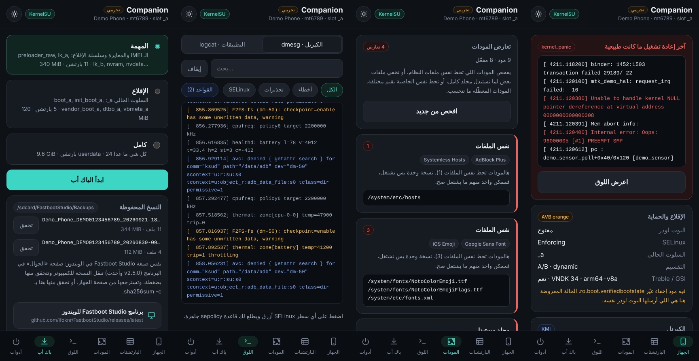
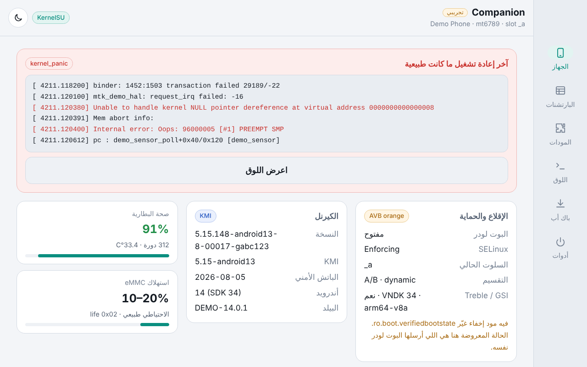

<p align="center">
  
</p>

<div dir="rtl">

<p align="center">
  <b>فحص الجهاز والبارتشنات واللوق اللحظي وتعارض المودات ونسخ احتياطي بـ SHA-256 — وحدة روت للقراءة فقط على جوالك.</b><br>
  <a href="README.md">English</a> · <a href="#تثبيت">التثبيت</a> · <a href="#الأقسام">الأقسام</a> · <a href="#الويندوز">مع برنامج الويندوز</a> · <a href="CHANGELOG.md">سجل التعديلات</a> · <a href="#مساعدة">المساعدة</a>
</p>

<p align="center">
  
  
  <a href="https://github.com/ifoknr/FastbootStudio-Companion/releases"></a>
  
  
  <a href="https://t.me/BeNeXTBrO"></a>
</p>

**Fastboot Studio Companion** وحدة روت لـ **Magisk و KernelSU و APatch**، رفيقة لبرنامج
[Fastboot Studio](https://github.com/ifoknr/FastbootStudio) في الويندوز. تعرض لك حقيقة جوالك،
وتتابع اللوق لحظياً، وتكشف التعارض بين المودات، وتاخذ نسخة احتياطية من البارتشنات بنفس صيغة
برنامج الويندوز، وكل هذا من الجوال نفسه.

**للقراءة فقط.** ما يشتغل شي وقت الإقلاع (لا `service.sh` ولا `post-fs-data.sh`)، فما يسبب بوت
لوب، وما يكتب على أي بارتشن. الكتابة الوحيدة هي النسخ الاحتياطية والتقارير في `/sdcard/FastbootStudio`.

> ✅ **مستقرة من 2.5.1.** وأرقام إصداراتها تمشي مع أرقام Fastboot Studio.
>
> **الجديد في 2.5.1:**
> - طلعت من التجريبي: أول إصدار رسمي.
> - تحذف النسخة الاحتياطية من الجوال مباشرة من تبويب الباك أب (`fbs delete`).
>
> **الجديد في 2.5:**
> - متوافقة مع صفحة **الجوال** في Fastboot Studio 2.5: المواصفات والحماية والتعارضات والنسخ الاحتياطية.
> - النسخة الاحتياطية ما ياخذ اسمها إلا لما تكتمل، فالبرنامج ما ينقل نسخة ناقصة.
>
> **الجديد في 2.4:**
> - تبويب **المودات** يكشف التعارض بين مودات الروت.
> - تصميم للتابلت والشاشات الكبيرة، وخط أكبر، ووضع ليلي ونهاري.
> - روابط برنامج الويندوز وقروب التيليجرام والسورس.
>
> كل التفاصيل في [سجل التعديلات](CHANGELOG.md).

<p align="center">
  
</p>

<a id="تثبيت"></a>
## التثبيت

نزّل ملف الـ zip من [الإصدارات](https://github.com/ifoknr/FastbootStudio-Companion/releases) وثبّته
من مدير الروت. بعدها توصلك التحديثات من مدير الروت نفسه.

- **KernelSU و APatch:** افتح واجهة الوحدة (WebUI) من صفحة المودات.
- **Magisk:** ما فيه واجهة خاصة فيه، فافتح الوحدة في [MMRL](https://github.com/MMRLApp/MMRL)
  أو WebUI X، أو اضغط **Action** في Magisk ويطلع لك تقرير نصي.

<a id="الأقسام"></a>
## الأقسام بالتفصيل

| القسم | |
|---|---|
| 📱 **الجهاز** | حالة البوت لودر و AVB زي ما قالها البوت لودر نفسه، حتى لو مود إخفاء غيّر `ro.boot.verifiedbootstate` · الكيرنل و KMI ومستوى الحماية · صحة البطارية واستهلاك الذاكرة eMMC/UFS · المعالج والحرارة والرام لحظياً |
| 🧯 **الصندوق الأسود** | إذا آخر إعادة تشغيل كانت بسبب كراش، يعرض لك لوق الإقلاع اللي قبل (pstore) مع أسطر الـ panic واضحة |
| 🗂️ **البارتشنات** | كل اللي في `by-name` بأحجامها وتصنيف أمانها (حرج، إقلاع، ممنوع)، وخريطة لمحتوى `super` |
| 🧩 **المودات** | كل المودات المثبتة، ووين تتعارض: مودين يحطون نفس ملف النظام، أو مود يستبدل مجلد كامل فيخفي ملفات مود ثاني، أو نفس الخاصية بقيم مختلفة |
| 📜 **اللوق** | الكيرنل و logcat لحظياً مع البحث والفلاتر. اضغط على أي سطر SELinux ويطلع لك سطر `sepolicy.rule` جاهز، أو اجمعها كلها مرة وحدة |
| 💾 **النسخ الاحتياطي** | المهمة (IMEI والمعايرة وسلسلة الإقلاع) أو الإقلاع (السلوت الحالي) أو كامل (كل شي ما عدا userdata)، وكل نسخة معها `SHA256SUMS` و `backup-info.txt`، وتقدر تتحقق منها على الجوال |
| 🛠️ **أدوات** | إعادة التشغيل للـ bootloader أو fastbootd أو recovery أو EDL (كوالكوم)، وحزمة دعم فني تخفي الـ IMEI والسيريال وعناوين MAC، والوضع الليلي واللغة |

عربي وإنجليزي حسب لغة الجوال، وليلي ونهاري حسب الجوال أو اختيارك.
على التابلت تنتقل التبويبات لشريط جانبي وتتوزع البطاقات على الشاشة:

<p align="center">
  
</p>

<a id="الويندوز"></a>
## مع Fastboot Studio في الويندوز

لما توصل الجوال وهو شغّال على أندرويد، البرنامج يقرا الوحدة عن طريق adb (بالروت):

- **من v2.4.0، صفحة الجهاز:** أمر `fbs facts`، ويحفظه لنفس الجوال. منه ياخذ الكيرنل و KMI عشان يفحص
  صورة boot قبل التفليش، ومدير الروت (ويسألك قبل تفليش صورة مروّتة بمدير ثاني)، وحالة AVB، وعدد
  التعارضات. ويظل يعرضها حتى لو الجوال صار في البوت لودر.
- **من v2.5.0، صفحة الجوال:** أمري `fbs info` و `fbs modules`. منها ياخذ مواصفات الجوال، وحالة AVB من
  البوت لودر نفسه، ومدير الروت، واستهلاك الذاكرة، وكل تعارض بين المودات. ويعرض النسخ الاحتياطية اللي في
  `/sdcard/FastbootStudio/Backups`، وينقل أي وحدة للكمبيوتر ويتحقق منها بـ `SHA256SUMS` بضغطة وحدة
  (النقل ما يحتاج روت).

مجلد النسخة الاحتياطية نفس اللي تسويه صفحة النسخ الاحتياطي في البرنامج بالضبط:

<div dir="ltr">

```
/sdcard/FastbootStudio/Backups/<model>_<serial>_<yyyyMMdd-HHmmss>/
  nvram.img  nvdata.img  boot_a.img  …
  SHA256SUMS        check with: sha256sum -c SHA256SUMS
  backup-info.txt
```

</div>

النسخة تنكتب في مجلد مخفي `.partial-…` وما ياخذ اسمها إلا لما تكتمل، فصفحة الجوال ما تعرض نسخة لسا
تنكتب. وفي اختبارات تتأكد من كل معلومة تقراها صفحة الجوال، فأي تغيير بالغلط ينكشف قبل النشر.

## سطر الأوامر

كل اللي تعرضه الواجهة جاي من سكربت واحد يطبع JSON، فتقدر تستخدمه من `adb shell` بعد:

<div dir="ltr">

```
su -c sh /data/adb/modules/fastboot_studio_companion/bin/fbs info
su -c sh /data/adb/modules/fastboot_studio_companion/bin/fbs help
```

</div>

<a id="مساعدة"></a>
## المساعدة والأخبار

- قروب التيليجرام: [t.me/BeNeXTBrO](https://t.me/BeNeXTBrO)
- الخاص: [t.me/IFOKNR1](https://t.me/IFOKNR1)
- برنامج Fastboot Studio للويندوز: [آخر إصدار](https://github.com/ifoknr/FastbootStudio/releases/latest)
- المشاكل والأفكار: [Issues](https://github.com/ifoknr/FastbootStudio-Companion/issues). ويساعد لو أرفقت
  حزمة الدعم من تبويب الأدوات، وهي تخفي الـ IMEI والسيريال وعناوين MAC.

نفس الروابط موجودة في الواجهة، تحت النسخ الاحتياطية وفي الأدوات.

---

## الحقوق

- التطوير والصيانة: **IFOKNR**، تيليجرام [@IFOKNR1](https://t.me/IFOKNR1) وقيت هب [ifoknr](https://github.com/ifoknr).
- مصنوعة لبرنامج [Fastboot Studio](https://github.com/ifoknr/FastbootStudio).

الوحدة منشورة برخصة [MIT](LICENSE).

</div>
