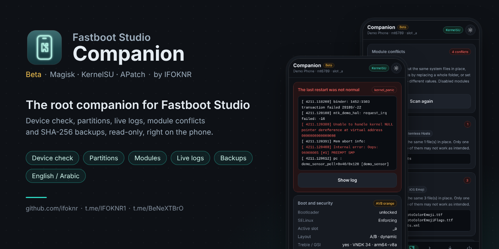
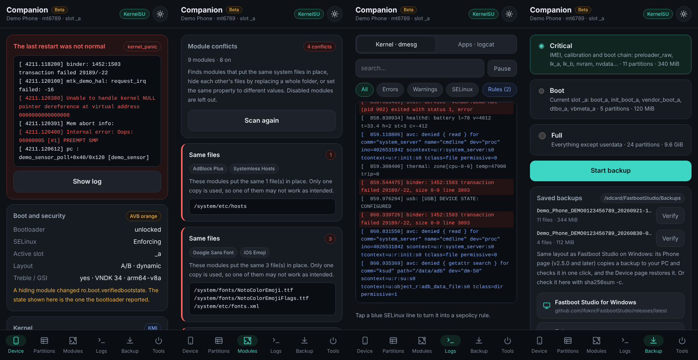
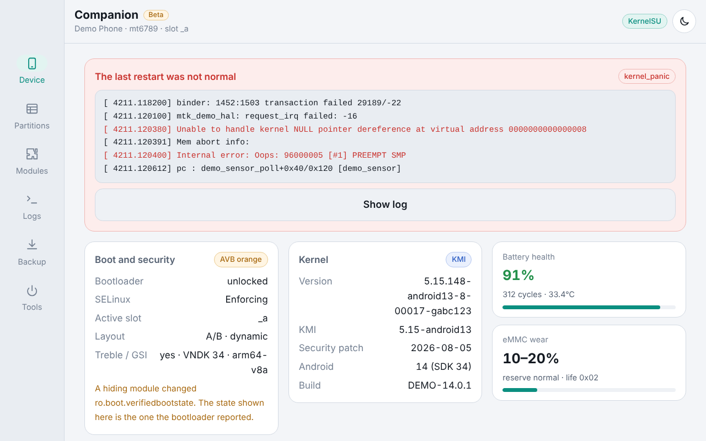

<p align="center">
  
</p>

<p align="center">
  <b>Device check, partitions, live logs, module conflicts and SHA-256 backups — a read-only root module for your phone.</b><br>
  <a href="README.ar.md">العربية</a> · <a href="#install">Install</a> · <a href="#tabs">Tabs</a> · <a href="#windows">With Fastboot Studio</a> · <a href="CHANGELOG.md">What's new</a> · <a href="#help">Help</a>
</p>

<p align="center">
  
  
  <a href="https://github.com/ifoknr/FastbootStudio-Companion/releases"></a>
  
  
  <a href="https://t.me/BeNeXTBrO"></a>
</p>

A root module for **Magisk, KernelSU and APatch** that goes with
[Fastboot Studio](https://github.com/ifoknr/FastbootStudio) on Windows. It shows what your phone
really is, watches its logs live, finds where your modules get in each other's way, and backs up
its partitions in the same layout the Windows app uses, all from the phone itself.

**Read-only by design.** Nothing runs at boot (no `service.sh`, no `post-fs-data.sh`), so it
cannot cause a bootloop, and it never writes to a partition. The only writes are backups and
reports under `/sdcard/FastbootStudio`.

> 🧪 **Beta.** The module is experimental. Its version numbers go along with Fastboot Studio's,
> and releases are published as pre-releases until it is marked stable.
>
> **New in 2.5:**
> - Works with the **Phone** page in Fastboot Studio 2.5: specs, security, conflicts and backups.
> - A backup gets its name only when it is complete, so the app never copies a half-written one.
>
> **New in 2.4:**
> - A **Modules** tab that finds conflicts between root modules.
> - A layout for tablets and large screens, bigger text, and day and night themes.
> - Links to the Windows app, the Telegram group and the source.
>
> Everything is in the [changelog](CHANGELOG.md).

<p align="center">
  
</p>

<a id="install"></a>
## Install

Download the zip from [Releases](https://github.com/ifoknr/FastbootStudio-Companion/releases) and
install it from your root manager. Updates arrive in the root manager after that.

- **KernelSU / APatch:** open the module's WebUI from the Modules page.
- **Magisk:** Magisk has no WebUI of its own. Open the module in [MMRL](https://github.com/MMRLApp/MMRL)
  or WebUI X, or press **Action** in Magisk for a text report.

<a id="tabs"></a>
## The tabs, one by one

| Tab | |
|---|---|
| 📱 **Device** | Bootloader and AVB state as the bootloader reported it, even when a hiding module rewrote `ro.boot.verifiedbootstate` · kernel, KMI and security patch · battery health and eMMC/UFS wear · live CPU clocks, temperature and memory |
| 🧯 **Black box** | When the last restart was a crash, the previous boot's kernel log (pstore) with the panic lines picked out |
| 🗂️ **Partitions** | Everything under `by-name` with sizes and a safety tag (critical, boot, never), plus a map of what is inside `super` |
| 🧩 **Modules** | Every installed module, and where they get in each other's way: two modules putting the same system file in place, one replacing a whole folder another adds to, or the same property set to different values |
| 📜 **Logs** | Live kernel log and logcat with search and filters. Tap an SELinux denial to get a ready `sepolicy.rule` line, or collect all of them at once |
| 💾 **Backup** | Critical (IMEI, calibration, boot chain), boot (current slot) or full (everything but userdata), each with `SHA256SUMS` and `backup-info.txt`. Verify any backup on the phone |
| 🛠️ **Tools** | Restart to bootloader, fastbootd, recovery or EDL (Qualcomm), a support bundle with IMEI, serial and MAC addresses masked, the theme and the language |

Arabic and English, following the phone's language; day and night, following the phone or your choice.
On a tablet the tabs move to a side rail and the cards spread out:

<p align="center">
  
</p>

<a id="windows"></a>
## With Fastboot Studio on Windows

When the phone is connected in Android, Fastboot Studio reads the module over adb (through su):

- **v2.4.0 and later, Device page:** `fbs facts`, kept for that phone. That gives the kernel and
  KMI it checks a boot image against before flashing, the root manager (it asks before flashing an
  image rooted with another one), the AVB state and how many module conflicts there are. It still
  shows them once the phone is in the bootloader.
- **v2.5.0 and later, Phone page:** `fbs info` and `fbs modules`. That gives the phone's specs,
  the bootloader's own AVB state, the root manager, storage wear and each module conflict. It also
  lists the backups in `/sdcard/FastbootStudio/Backups`, then copies one to the PC and checks it
  against `SHA256SUMS` in one click (no root needed for that part).

A backup folder looks exactly like one made by Fastboot Studio's Backup page:

```
/sdcard/FastbootStudio/Backups/<model>_<serial>_<yyyyMMdd-HHmmss>/
  nvram.img  nvdata.img  boot_a.img  …
  SHA256SUMS        check with: sha256sum -c SHA256SUMS
  backup-info.txt
```

A backup is written to a hidden `.partial-…` folder and gets its name only when it is done, so the
Phone page never offers one that is still being written. `tests/run.sh` checks every key the
Phone page reads, so a change here cannot break it unnoticed.

## Command line

Everything the WebUI shows comes from one script, which prints JSON, so it can be used from
`adb shell` too:

```
su -c sh /data/adb/modules/fastboot_studio_companion/bin/fbs info
su -c sh /data/adb/modules/fastboot_studio_companion/bin/fbs help
```

<a id="help"></a>
## Help and news

- Telegram group: [t.me/BeNeXTBrO](https://t.me/BeNeXTBrO)
- Private message: [t.me/IFOKNR1](https://t.me/IFOKNR1)
- Fastboot Studio for Windows: [latest release](https://github.com/ifoknr/FastbootStudio/releases/latest)
- Bugs and ideas: [Issues](https://github.com/ifoknr/FastbootStudio-Companion/issues). A support
  bundle from the Tools tab helps; it masks the IMEI, serial and MAC addresses.

The same links are in the WebUI, under the backups and in Tools.

## For developers

```
SHELLS="dash mksh busybox-sh" sh tests/run.sh   # fbs against a fake phone
CHROME=google-chrome sh tests/webui-smoke.sh    # the WebUI with the demo bridge
sh tools/build.sh                               # dist/FastbootStudio-Companion-vX.Y.Z.zip
```

`module/webroot/index.html` also opens in a normal browser, where `demo.js` stands in for the
root manager with a made-up phone (`?lang=ar`, `?theme=light` and `#log` pick the language, theme and tab).

---

## Credits

- Developed and maintained by **IFOKNR** — Telegram [@IFOKNR1](https://t.me/IFOKNR1) · GitHub [ifoknr](https://github.com/ifoknr)
- Made for [Fastboot Studio](https://github.com/ifoknr/FastbootStudio)

Released under the [MIT License](LICENSE).
